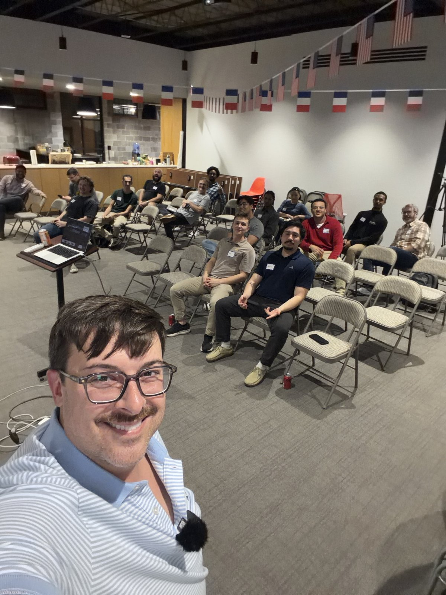
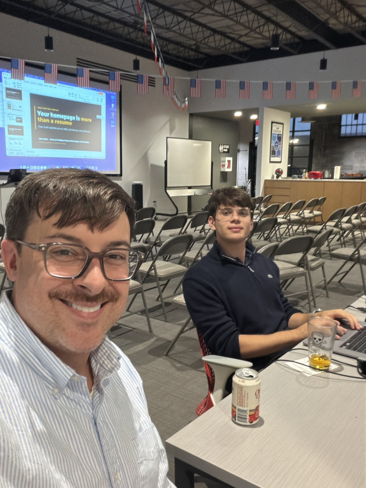

<!--
DRAFT SCAFFOLD. Luke is talking Claude through the details; prose below is a rough pass to react to.
-->

Tonight at the Richmond AWS User Group I gave a talk called **Your Homepage Is More Than a Resume**: how I built [lukelittle.com](https://lukelittle.com) on AWS, and how you can build yours.

## Why a Homepage

<!-- TODO(Luke): the core pitch. Why a homepage beats a resume. -->

## How This Site Is Built

This site is a [Hugo](https://gohugo.io/) static site, and the whole stack costs about $3 a year to host:

- **Hugo** with the PaperMod theme generates plain HTML from Markdown.
- **Amazon S3** stores the files and **CloudFront** serves them over HTTPS, with a free certificate from **ACM** and DNS in **Route 53**.
- **Terraform** defines all of the infrastructure.
- **GitHub Actions** builds the site on every push, syncs it to S3, and invalidates the CloudFront cache, authenticating to AWS with OIDC instead of stored keys.

The code is all [on GitHub](https://github.com/lukelittle/homepage) if you want to borrow it.

<!-- TODO(Luke): anything from the live demo / what you showed on screen -->

## Build Yours

If you're a student and want the fastest path, start with the [student branding starter](): a Hugo site on GitHub Pages you can have up in about ten minutes. When you outgrow it, move it to S3 and CloudFront.

## Thank You

<!-- TODO(Luke): thank the host venue, sponsors, whoever's in the second photo, and the attendees -->

See you at the next Richmond AWS User Group meetup.
